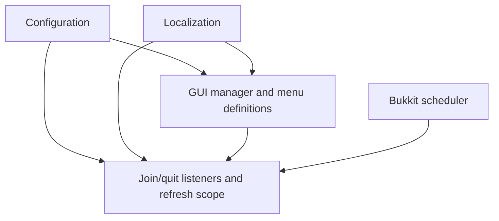

# MinecraftDevKit Bukkit Integration Example

This standalone plugin composes MinecraftDevKit's lifecycle, typed configuration, localization, permissions, Cloud commands, inventory GUI, and scheduler APIs. The same application sources target Spigot or Paper; Paper adds an optional GUI extension for native Adventure metadata.

## Platform and build

- Spigot or Paper `1.21.11`
- Java `21`
- Build from this directory with the repository wrapper:

```powershell
../../gradlew.bat build
```

The default dependency mode is Maven Local. From the repository root, publish the repository modules locally with `.\gradlew.bat publishToMavenLocal`; then run the independent build from this directory. The independent build can also resolve a published JitPack version explicitly:

```powershell
../../gradlew.bat -PmdkRepository=jitpack -PmdkVersion=<published-version> build
```

The default `mdkPlatform` is `paper`. To compile the same plugin sources against Spigot and package the required Adventure runtime:

```powershell
../../gradlew.bat -PmdkPlatform=spigot clean build
```

The Shadow JAR is `build/libs/minecraftdevkit-bukkit-integration-example-0.1.0-SNAPSHOT.jar`. Both modes bundle MinecraftDevKit and required runtime libraries and relocate Cloud and SnakeYAML. Paper mode includes `devkit-paper-gui` and leaves Paper/Adventure API classes to the server. Spigot mode compiles against Spigot API and bundles Adventure API because Spigot does not provide it. Both modes produce the same filename, so build one mode at a time and copy the intended artifact. The permissions Gradle plugin generates plugin permission declarations from `IntegrationPermissions`; Cloud registers `/mdkintegration` at runtime, so the checked-in `plugin.yml` has no duplicate command root.

## Framework roles

- **Lifecycle** owns services and establishes startup/shutdown order.
- **Config** validates typed YAML values and preserves dirty state on failed reloads.
- **Localization** resolves English and German text per viewer and reloads external YAML overrides.
- **Permissions** declares the plugin's permission nodes once in Java.
- **Commands** provides a typed Cloud command tree.
- **GUI** owns protected inventories, per-viewer radio selection, navigation, and pagination.
- **Scheduler** groups periodic and asynchronous work in a lifecycle-owned scope.

The actual service graph is shared by Spigot and Paper. The scheduler service binds the Bukkit scheduler implementation for the selected server:



Services start in stable registration order when dependencies permit. Shutdown reverses the dependency order: feature listeners and their task scope close first, then menus, scheduler, localization, and configuration. `BukkitLifecycle` delegates synchronous startup and shutdown to the platform's traditional Bukkit primary thread. The Cloud adapter uses its legacy Bukkit command manager; Paper enhancements activate only when Cloud detects them. This build establishes Spigot/Paper API compile compatibility, not live runtime verification.

## Commands and permissions

| Command | Purpose | Permission |
| --- | --- | --- |
| `/mdkintegration` or `/mdki` | Open the main menu | `mdk.integration.use` |
| `/mdkintegration menu` | Open the main menu | `mdk.integration.use` |
| `/mdkintegration status` | Show lifecycle state, service states, dirty state, open menus, and online count | Any sender |
| `/mdkintegration save` | Save pending configuration changes | `mdk.integration.admin` |
| `/mdkintegration reload` | Run ordered config and translation reload hooks | `mdk.integration.admin` |
| `/mdkintegration demo delayed` | Schedule a 40-tick message | `mdk.integration.use` |
| `/mdkintegration demo async` | Calculate off-thread, then message on the server thread | `mdk.integration.use` |

`mdk.integration.use` defaults to allowed. Settings and admin nodes default to operators through the typed catalog and generated metadata. GUI buttons also re-check the Bukkit permission during click dispatch; hiding a button is not the authorization boundary.

## Configuration and persistence

`IntegrationConfig.SCHEMA` is the source of truth. It supplies defaults for:

```yaml
features:
  notifications-enabled: true
  show-online-count: true
gui:
  refresh-interval-ticks: 40
```

The refresh interval is validated to `10..1200` ticks. Settings toggles update the in-memory `ConfigStore` and show an unsaved indicator; they do not silently write the file. Use `/mdkintegration save` or the settings menu save button to persist with the safe external-change policy. If the file changed since it was loaded, save reports a conflict instead of overwriting the external edit.

The reload hook uses the YAML handle's default `REJECT_IF_DIRTY` policy. Save pending changes before reloading. A parse/validation failure leaves the active snapshot unchanged. Reload hooks are ordered but not transactional: a successful config reload is not undone if the later localization hook fails, and the command reports partial failure honestly.

## Localization

`src/main/resources/lang/en.yml` and `de.yml` provide base catalogs. At startup they are copied to the plugin data folder under `lang/`; files in that directory override bundled translations. English is the configured fallback for unsupported locales. GUI item names, lore, and page text resolve for each viewer at render time. Use `/mdkintegration reload` after editing translations; currently open menus refresh their content. Bukkit inventory titles are selected when opened, so reopen a menu to see a changed title.

The strict localization scan builds a reference manifest from the command definition and the GUI/application text catalog and checks English/German coverage and placeholders during `check`/`build`.

## GUI walkthrough

The main chest menu contains a profile icon, online player list, settings, status, and close action. The player list uses `PagedGui` with 28 content slots, a page indicator, previous/next controls, and an empty state. Join/quit events and the scoped periodic refresh recalculate the online list and page bounds. Selecting an entry opens a detail menu; Back restores the original list session and page.

Settings contain a permission-protected configuration toggle and a session-local radio group for compact/detailed presentation. The toggle's getter reads the current typed config value, and its setter marks the store dirty. The notifications setting controls a localized join message. Save and reload controls are revalidated against permissions at click time. `GuiManager` owns click/drag protection; the example does not implement inventory event security itself.

All menu item text is built at render time from the viewer's locale. ItemStack construction and GUI mutation occur on the server thread. The periodic refresh uses the configured tick interval; server lag means ticks do not represent exact wall-clock seconds.

## Scheduler and ownership

`Features` owns a child `TaskScope` created from `BukkitTaskScheduler`. It refreshes current player views at the configured interval, replaces that repeating task when the interval changes, and is closed before the scheduler. The delayed command uses that same scope. The async demo performs only plain arithmetic off-thread, hands the result to `thenSync`, and looks up the player by UUID on the server thread before messaging. Work already executing asynchronously is not forcibly interrupted on shutdown, but the scope prevents its queued synchronous continuation from running after closure.

The localization service, configuration handle, and scheduler are returned from lifecycle factories and closed automatically. The GUI manager, feature task scope, listener unregister action, and config subscription are registered with their `LifecycleContext` as soon as ownership begins. The command adapter is created during `onEnable` and its platform registrations are associated with the plugin by Cloud/Paper.

The service wiring follows the lifecycle API directly:

```java
LifecycleManager manager = LifecycleManager.builder()
    .service(CONFIG, context -> YamlConfigHandle.createIfMissing(configPath, IntegrationConfig.SCHEMA))
    .service(TEXT, context -> createLocalization(plugin))
    .service(SCHEDULER, context -> BukkitTaskScheduler.create(plugin))
    .service(MENUS, context -> createMenus(context.require(CONFIG), context.require(TEXT)), CONFIG, TEXT)
    .service(FEATURES, context -> createFeatures(context.require(CONFIG), context.require(MENUS),
        context.require(TEXT), context.manage(context.require(SCHEDULER).scope())),
        CONFIG, MENUS, TEXT, SCHEDULER)
    .build();
```

Factories above are shown as the example's own service constructors. The configuration-backed toggle binds to the real typed store:

```java
.bind(context -> config.store().get(IntegrationConfig.NOTIFICATIONS),
      (context, enabled) -> config.store().set(IntegrationConfig.NOTIFICATIONS, enabled))
```

The asynchronous demonstration uses the feature scope and returns to Paper's synchronous context without blocking:

```java
featureScope.async().submit(() -> calculatePlainData())
    .thenSync(value -> {
        Player online = Bukkit.getPlayer(playerId);
        if (online != null) online.sendMessage(Component.text(value.toString()));
    });
```

## Installation and manual Paper validation

Build the Shadow JAR, copy `build/libs/minecraftdevkit-bukkit-integration-example-0.1.0-SNAPSHOT.jar` into a Paper 1.21.11 server's `plugins` directory, and start the server under its own valid EULA configuration. No live server test is claimed by this project build.

Suggested manual checks:

1. Start with no data folder; confirm default config and `lang/en.yml` / `lang/de.yml` appear and startup logs list the service order.
2. Run `/mdkintegration status` from console and a player. Confirm status works for console and menu commands reject console cleanly.
3. Use a German client and an English client to check viewer-specific menu titles/items, player heads, and the page indicator.
4. Open the player list, join/leave with another authorized player, and verify counts, page clamping, item identity, and Back returning to the same page.
5. Try left/right, shift-click, hotbar number keys, offhand swap, double-click collection, drags across top slots, bottom-inventory interactions, and Escape. GUI display items must remain protected according to `devkit-bukkit-gui`'s `PROTECT_GUI` policy.
6. Toggle notifications; confirm the unsaved marker appears. Save, confirm it clears, then edit the YAML externally and make another unsaved change; verify save reports a conflict and does not overwrite the external file.
7. Put an out-of-range refresh interval in YAML and reload. Confirm the invalid file is reported and the last valid in-memory value remains active. Save pending in-memory edits before retrying reload.
8. Edit English/German text, invoke reload, and refresh an open menu. Reopen it to verify its title as well.
9. Remove settings/admin permission while a menu is open; confirm the toggle/save/reload actions no longer execute.
10. Run both scheduler demos; disable the plugin while the async task is in flight and confirm no later player callback occurs. Check logs for ordered cleanup and errors.

The offline-player skin service is not part of this integration example; player-list heads use online Paper profiles, which avoids external offline profile lookup. Folia is not supported. Real inventory transaction semantics and native scheduler thread ownership require the manual Paper checks above.
