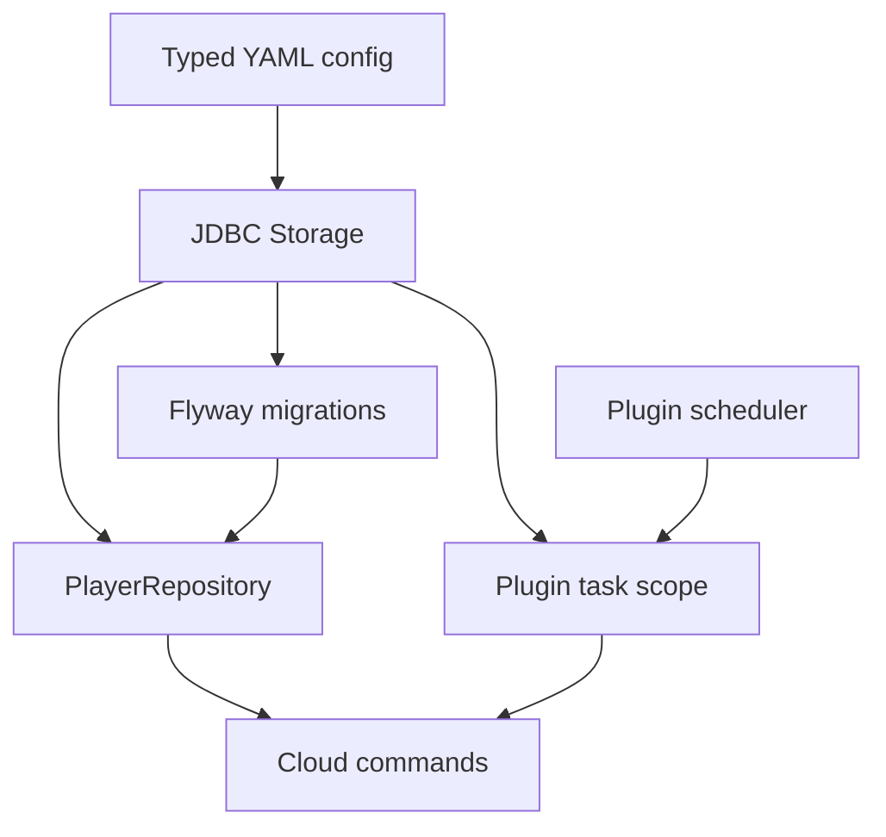

# Bukkit Storage Example

This standalone plugin demonstrates asynchronous player data persistence with MinecraftDevKit. It composes typed YAML settings, lifecycle-owned JDBC storage, Flyway SQL migrations, explicit SQL, Cloud commands, typed permission declarations, and a lifecycle-owned scheduler scope for returning query results to the Bukkit server thread.

## Platform and build

- Spigot or Paper 1.21.11
- Java 21
- SQLite works by default and stores `players.db` below the plugin data directory.
- MySQL and MariaDB are selectable after including the matching JDBC driver.

Build after publishing the modules to Maven Local:

```powershell
.\gradlew.bat --no-build-cache publishToMavenLocal
.\gradlew.bat -p examples/bukkit-storage-example clean build
```

The standalone build defaults to Maven Local. For JitPack, pass `-PmdkRepository=jitpack -PmdkVersion=<version>`. Default packaging has no network JDBC driver. To build for MySQL, add `runtimeOnly("com.mysql:mysql-connector-j:26.10.0")`; for MariaDB, add `runtimeOnly("org.mariadb.jdbc:mariadb-java-client:3.5.7")` to the example's Gradle dependencies and include the selected driver's required license notices when redistributing the shaded JAR. MySQL Connector/J 26.10.0 targets modern MySQL servers; MariaDB Connector/J 3.5.7 supports Java 21 and MariaDB/MySQL servers.

The same source can be compiled against Spigot with `-PmdkPlatform=spigot`; the default is Paper. Spigot mode includes compatible Adventure runtime classes because Spigot does not supply them. Neither mode has live runtime verification until run through the optional platform acceptance harness.

## Service graph



Startup follows declared dependencies. Shutdown closes the repository and migrations, then the task scope and scheduler before Storage, and configuration last. The lifecycle owns the Storage, BukkitTaskScheduler, and TaskScope instances. Repositories retain no connections.

## Commands and permissions

| Command | Permission | Behavior |
| --- | --- | --- |
| `/mdkstorage balance` | `mdk.storage.balance` | Asynchronously reads your saved balance, then schedules the message on the server thread. |
| `/mdkstorage add <player> <amount>` | `mdk.storage.admin` | Atomically adds coins using a SQL upsert. |
| `/mdkstorage set <player> <amount>` | `mdk.storage.admin` | Sets the player's stored balance. |
| `/mdkstorage status` | `mdk.storage.admin` | Shows lifecycle state and a non-sensitive backend label. |

Permission nodes are typed Java values. The Gradle plugin generates `plugin.yml` metadata, and Cloud checks permissions at command execution.

## Configuration

The schema uses `ConfigKey` and `ConfigSchema`. Missing files are generated with defaults and validated on load. The password key uses sensitive-value diagnostics.

```yaml
config-version: 1
database:
  type: SQLITE
  sqlite:
    filename: players.db
  mysql:
    host: localhost
    port: 3306
    database: minecraft
    username: minecraft
    password: ''
    pool-size: 8
```

Choose `SQLITE`, `MYSQL`, or `MARIADB`. Networked backends need their JDBC driver at runtime. Configure TLS with the selected driver's documented settings; the example does not disable certificate validation. Changing a live database endpoint does not hot-swap the pool. Apply such changes through a controlled lifecycle replacement or restart.

## Repository and migrations

The example applies `src/main/resources/db/migration/V1__create_players.sql` before constructing the repository. Flyway records migration versions and checksums. Every SQL value uses `SqlParameters`; the increment command uses an atomic backend-specific upsert to avoid a read-modify-write lost update.

```java
Storage storage = Storage.builder().sqlite(dataFolder.resolve("players.db")).build();
StorageMigrations.builder(storage).locations("classpath:db/migration").migrate();

StorageTask<Optional<Long>> balance = storage.async().queryOne(
    "SELECT coins FROM players WHERE uuid = ?",
    SqlParameters.of(playerId.toString()),
    row -> row.getLong("coins")
);
```

Storage owns its HikariCP pool and bounded database executor. Each query releases its JDBC resources. Transaction callbacks share one connection and roll back on failure. SQLite uses one connection, per-connection foreign keys, a five-second busy timeout, and WAL for file-backed databases. SQLite is still single-writer; avoid large databases on network filesystems.

Cancellation is logical. Queued work is removed when the owned executor supports it, and the result stage is cancelled; an active JDBC call may continue. The task scope prevents late results from scheduling server callbacks after lifecycle shutdown.

## Manual Paper checklist

1. Install the shaded JAR into a Paper 1.21.11 test server running Java 21.
2. Start with no data folder and confirm `config.yml`, `players.db`, and Flyway history are created.
3. Run `/mdkstorage status`; verify it shows `sqlite` without a password or JDBC URL.
4. Run `/mdkstorage balance`, then grant admin permission and test add/set.
5. Restart and verify persistence.
6. Select MySQL/MariaDB only after adding that driver's dependency and valid server settings; verify TLS with normal certificate checks.
7. Stop the plugin while a query is queued; confirm no post-disable callback appears.
8. Test invalid config, missing driver, inaccessible database, and migration failure in a disposable environment.

## Limits

The example is JVM- and SQLite-tested; this does not prove live Paper thread affinity. No live Paper, MySQL, or MariaDB server is required by the normal test suite. SQL dialect details and connection options vary by driver. DDL rollback depends on the backend. The adapter targets traditional Paper/Bukkit scheduling and does not claim Folia support.
